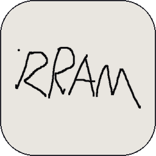
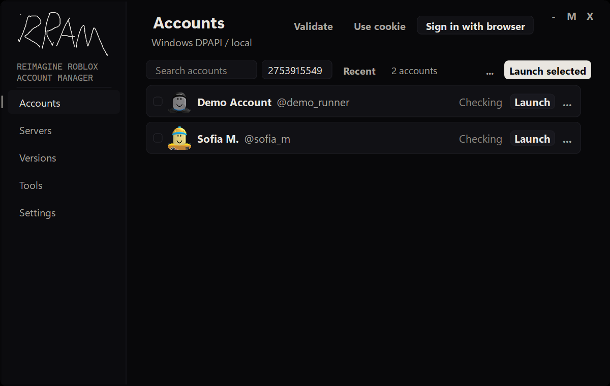
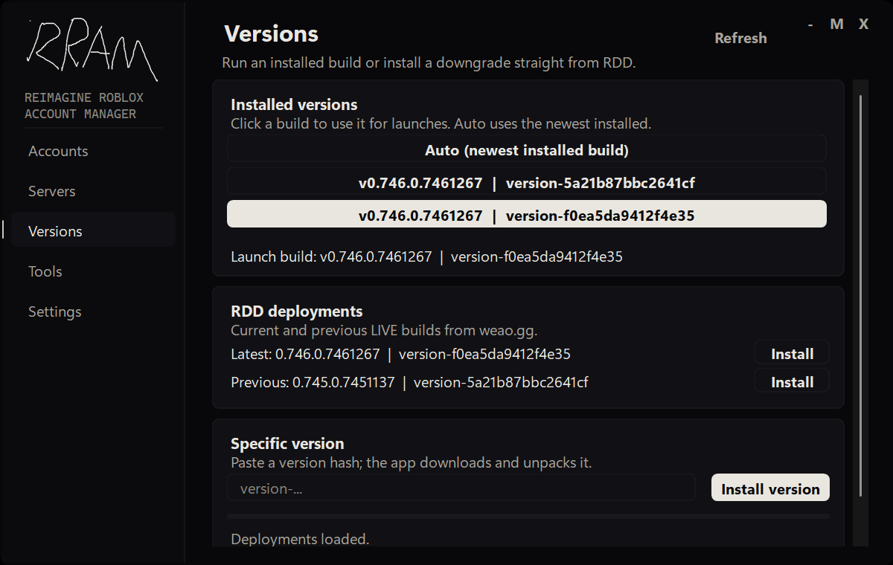
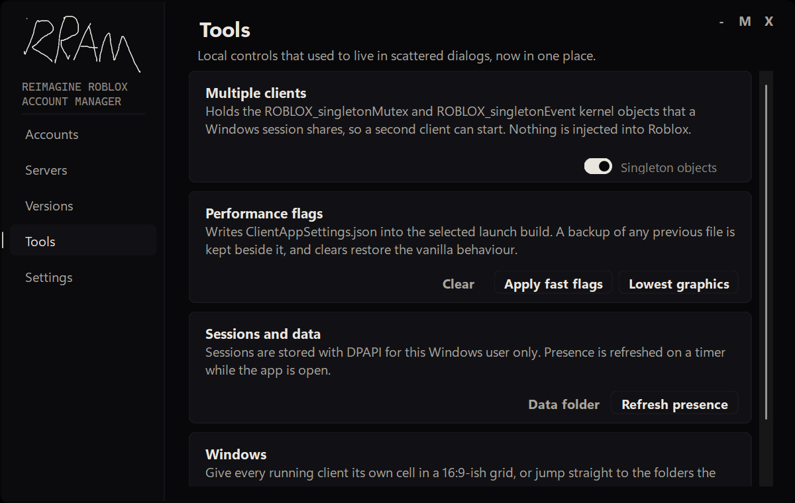
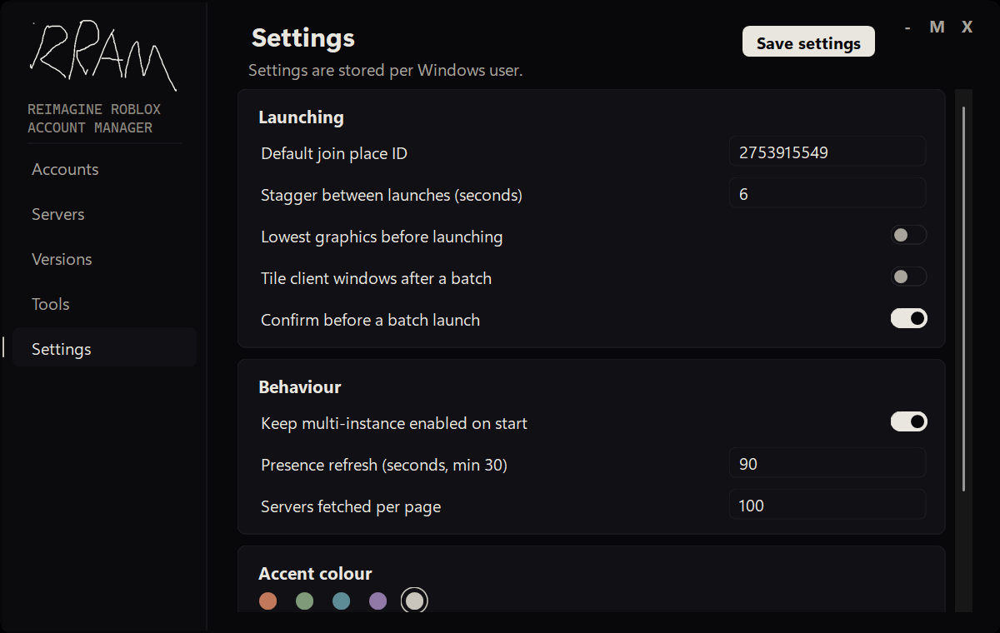

> **fork of the fork** — rram is a modified fork of [bruhger12/roblox-account-manager-reimagined](https://github.com/bruhger12/Roblox-Account-Manager-Reimagined), which is itself a fork of [ic3w0lf22/roblox-account-manager](https://github.com/ic3w0lf22/Roblox-Account-Manager). same purpose, new shell, new branding and a quality-of-life pass

# rram (remaster roblox account manager ) 🎮

desktop account manager for roblox 

<p align="center"></p>

---

### how it looks

<p align="center">
  
  
</p>
<p align="center">
  
  
</p>

---

### features

- **browser sign-in**: log into roblox once; the app reads the session and wipes the browser cookie jar afterwards.
- **local-only sessions**: cookies are protected with windows dpapi for the current user. no passwords, no third-party server.
- **readable account cards**: one-line cards with avatar, handle, presence, batch launch and a context menu for the rest.
- **server browser + launcher**: public servers with population, ping and fps; join as any selected account.
- **version manager**: pin an installed roblox build, or pull current / previous / specific RDD packages.
- **no injected client code**: multi-instance only holds the two kernel objects roblox uses; fast flags are backed up and reversible.

---

### quick start

#### option 1: just use the release (windows)
download the latest release zip from the [releases page](../../releases/latest), extract it and run `RRAM.exe`. no .net install, no setup.

#### option 2: build from source (optional)
```bat
dotnet publish "src\RamReimagined\RamReimagined.csproj" -c Release -r win-x64 --self-contained true -o release
release\RRAM.exe
```

---

### how to sign in

1. open rram.
2. hit **sign in with browser**.
3. log into roblox in the window that opens.
4. the session is captured, validated, encrypted locally and the browser jar is cleared.
5. done. the account card appears and is ready to launch.

you can also paste a single cookie, import a list, or open an existing account in the browser.

---

### what changed in this fork

- rebuilt the shell as a quiet dark desktop app with no icon pack and no injected client code.
- rebranded the project as **rram / re-ram** with the hand-drawn wordmark you see in the rail.
- the account row is one line: `name + @handle` on the left, status and launch on the right.
- added local roblox build selection and RDD download alongside the original account tools.
- moved local data to `%APPDATA%\RRAM` and migrates the old account-manager folder on first launch.

---

### data & privacy

everything stays on the machine, under `%APPDATA%\RRAM`:

- `accounts.json`: session cookies protected with dpapi, plus tags and notes.
- `settings.json`: launch, refresh, accent and recent-place preferences.
- `avatars\`: cached headshots.
- `browser\`: the disposable webview2 profile.

roblox's own files are only touched by the optional fast-flag and graphics tools, which keep a `.ram-backup` beside anything they rewrite.

---

### requirements

- windows 10 or 11, x64.
- roblox player installed for the windows user running the app.
- microsoft edge webview2 runtime (it ships with current windows / edge).
- .net 9 sdk only if you build from source; the prebuilt release bundles the .net runtime.

---

### license

gpl-3.0, inherited from the original project. see [LICENSE](LICENSE). not affiliated with roblox corporation.

### credits

original project: [ic3w0lf22](https://github.com/ic3w0lf22/Roblox-Account-Manager).  
intermediate reimagined fork: [bruhger12](https://github.com/bruhger12/Roblox-Account-Manager-Reimagined).  
rram fork and ui pass: this repository 
